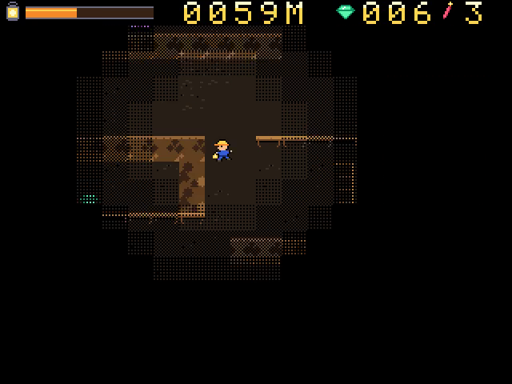
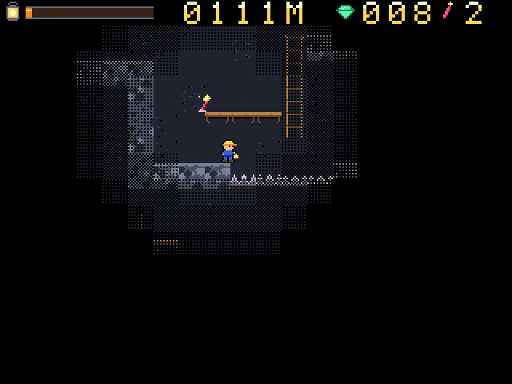

# Lantern Deep

Descend an endless mine shaft with a lantern that burns oil every second. Collect gems, throw flares, avoid creatures in the dark and buy supplies at lift stations.

For the Zeal 8-bit computer with the Video Board, running Zeal 8-bit OS.

 

## Controls

Menu prompts default to a connected SNES pad and follow the last device used
in the menu. The selected keyboard/pad display stays fixed during the game.

| Action | Keyboard | SNES pad |
|---|---|---|
| Move | Left / Right | D-pad |
| Climb ladders | Up / Down | D-pad |
| Jump (hold for height) | Z or Space | B |
| Throw a flare | X | A |
| Dim the lantern (hold) | A or S | Y or X |
| Start / pause | Enter | Start |
| Quit (title screen) | Right Shift | Select |

## How to play

- Keep enough oil to light the way. Holding the dim control saves oil but reduces visibility.
- Collect gems and use lift stations to buy supplies and upgrades.
- Use ladders, platforms and flares to descend safely. Your score rewards depth and gems.

## Build

Install the Zeal Development Environment (ZDE) and its SDK dependencies, then run
these commands from this repository:

```sh
zde deps install zgdk
zde deps install zar
zde cmake
```

The build produces `bin/lanterndeep.bin` and `bin/lanterndeep.zar`.
Use a current ZGDK installation.

## Run

For Zeal-NativeEmulator, mount the output folder as HostFS:

```sh
zeal-native -r /path/to/os_with_romdisk.img -H bin
```

At the ZOS prompt:

```text
cd H:/
exec lanterndeep.bin
```

On hardware, copy the `.bin` and `.zar` together and run the game from that folder.

Build variants, asset editing and optional development tools are documented in
[the development guide](docs/development.md).

## License

Copyright 2026 David Higgins. Game code and original assets are licensed under
[Apache License 2.0](LICENSE). External SDKs and tools retain their own licenses.
